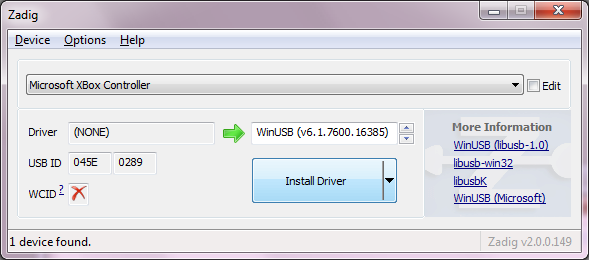
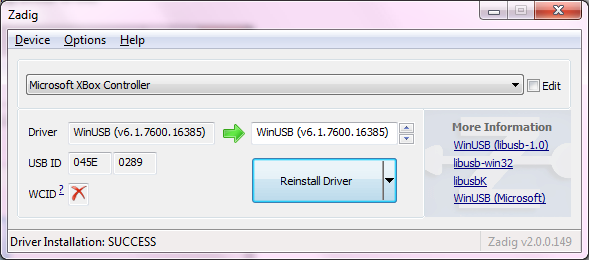

# Zadigでブラウザ印刷を準備する

Windows PCにUSB接続したレシートプリンターを、Chrome / EdgeのWebUSBから使えるようにします。
WinUSBの割り当てには、ダウンロードして起動できるGUIツールの[Zadig](https://zadig.akeo.ie/)を使います。
`wdi-simple.exe`やビルド環境は不要です。ドライバーの変更時にWindowsの管理者権限が必要です。

この手順はRP-E11を例にしています。**画像はZadig公式ガイドの別機器・旧バージョンの画面例で、
RP-E11の実機画面ではありません。画像中の機器名やUSB IDを真似せず、自分のプリンターの値を使ってください。**
Windowsのバージョンによって表示が異なります。Windows実機での本手順の実行は未確認です。

## 1. 対象のプリンターと現在の設定を確認する

プリンターをPCへUSB接続して電源を入れます。対象プリンターは1台だけにし、印刷ソフトやメーカーの設定ツールを終了します。
WinUSBへ切り替えると、このUSB接続での通常のWindows印刷は使えなくなる可能性があります。
戻す場合に備えて、現在のドライバーを控え、メーカーのドライバーインストーラーを確保します。

このプロジェクトで調べたRP-E11の値は次のとおりです。

| 確認項目 | 今回のRP-E11の値 |
| --- | --- |
| USB製品名 | `SII RP-E10 Series.`。RP-E11でもシリーズ名で表示される場合がある |
| VID / PID | `0619` / `0123` |
| アプリが使うインターフェース | `0` |
| ZadigのMI欄 | 複合機器の対象の子なら`00`。単一機器ではMI欄がなくてもよい |

別の機種・個体では、まずWindowsの「デバイス マネージャー」→対象機器の「プロパティ」→
「詳細」→「ハードウェアID」で値を確認します。例えば以下のように表示されます。

```text
USB\VID_0619&PID_0123
USB\VID_0619&PID_0123&MI_00
```

上は単一機器等のID、下は複合機器の子のIDの例です。両方が必ず表示される意味ではありません。

機器を探しにくい場合は、このリポジトリの調査スクリプトでも確認できます。調査だけなら管理者権限は不要です。

```powershell
# 接続中のUSB機器から候補を選び、現在のサービス名・INFも確認する。
.\winusb\Find-WebUsbPrinter.ps1
```

保存を選ぶと`winusb/state/discovery/実行ごとのID/device.json`に調査結果が残ります。
今回のRP-E11なら、設定済みプロファイルを使った読み取りもできます。

```powershell
.\winusb\Setup-WebUsbPrinter.ps1 -Model rp-e11 -Action Inspect | Format-List
```

Zadigで設定するだけなら、機種別JSONを新たに作る必要はありません。
調査結果をZadigの画面に対応させると次のようになります。

| 調査結果 | Zadigで確認する場所 |
| --- | --- |
| `BusReportedName` / `FriendlyName` | 上部の機器一覧。Windows側と表示名が異なる場合はUSB IDも比較する |
| `VendorId` / `ProductId`、または`HardwareIds`のVID/PID | `USB ID`のVID/PID |
| `HardwareIds`に`MI_00`などがあればそのMI | 対象の子インターフェース。機器名の`Interface 0`などとMI欄を確認する |
| `Service` | 左側の現在の`Driver`。表記は異なる場合があるが、`usbprint`なら`USBPRINT`等が目安 |
| `DriverInfPath` | 復元用に控える。Zadigの画面では直接確認できない場合がある |

追加ドライバーのバックアップが必要なら、管理者PowerShellで実際の`DriverInfPath`を指定します。
次の`oem42.inf`は例なので、自分の値に置き換えてください。Windows標準の`usbprint.inf`等はOSが持っています。

```powershell
New-Item -ItemType Directory -Path C:\PrinterDriverBackup -Force
pnputil.exe /export-driver oem42.inf C:\PrinterDriverBackup
```

GUIで設定する場合、共通PSの`Install`による自動バックアップは実行されません。

## 2. Zadigをダウンロードして起動する

1. [Zadig公式サイト](https://zadig.akeo.ie/)のDownload欄から実行ファイルをダウンロードします。
2. 実行ファイルのプロパティのデジタル署名は、公式サイトの説明では`Akeo Consulting`です。
3. Zadigを起動し、Windowsの管理者権限の確認を許可します。

Zadig自体のインストール作業は不要です。WinUSB本体はWindows標準のドライバーで、
Zadigは対象USB機器とWinUSBの関連付けを行います。

## 3. プリンターを選ぶ

1. メニューの **Options → List All Devices** を選びます。既にドライバーが入っている機器も表示されます。
2. 上部の機器一覧から、手順1で確認したプリンターを選びます。
3. **USB IDのVID/PIDが一致していること**を確認します。今回のRP-E11なら`0619`と`0123`です。
4. 複合機器なら対象の子インターフェースも確認します。USBハブや`USB Composite Device`という親を選ばないでください。
   `Ignore Hubs or Composite Parents`は既定の有効状態を維持します。



**上の画像はXboxコントローラーの例です。画像の`045E:0289`はRP-E11の値ではありません。**
見る場所は、上部の機器名、左下の`USB ID`、左側の現在の`Driver`、右側の変更先です。
プリンターが見つからなければ抜き差しによる一覧の変化も確認し、IDが一致しない場合は先へ進まず調査し直します。

## 4. 変更先をWinUSBにして適用する

1. 右側のドライバー選択を **WinUSB** にします。バージョン番号は画面例と同じでなくて構いません。
2. 左側が現在のドライバー、右側が`WinUSB`になっていることと、対象のUSB IDを再確認します。
3. **Replace Driver** または **Install Driver** を押します。既存のドライバー状態によりボタン名が変わります。
4. 完了を待ちます。

左側が既に`WinUSB`なら、まず手順5で確認してください。正常なら再インストールは不要です。
手順4で使うのはZadigのボタンであり、PowerShellの`-Action Install`は実行しません。

## 5. 成功を確認する



上も別機器の例です。下部の成功表示と、左側の現在のドライバーが`WinUSB`になったことを確認します。
OSから再起動などを案内された場合は従います。必要に応じてUSBを抜き差しします。

RP-E11は次の読み取り専用コマンドで、WinUSBサービス、問題コード、公開GUIDを確認できます。
この確認に`wdi-simple.exe`は不要です。

```powershell
.\winusb\Setup-WebUsbPrinter.ps1 -Model rp-e11 -Action Verify | Format-List
```

PowerShellを使わない場合は、デバイスマネージャーで対象機器の「ドライバーの詳細」に
`winusb.sys`が含まれ、警告マークが出ていないことを確認してから手順6へ進みます。

別機種は`Find-WebUsbPrinter.ps1`で再調査し、現在の`Service`が`WinUSB`になったかを確認します。
これはブラウザ接続の確認まで代替するものではありません。
Zadigの完了表示後も確認に失敗する場合は、自動再送せず、再接続後に状態を確認します。

## 6. ブラウザから接続して印刷する

対象プリンターを接続したWindows PCのChrome / Edgeで、[Webアプリの起動手順](../web/README.md#起動)に従います。
このPCで開発サーバーを起動する例は以下です。リポジトリのNode.js・pnpm環境が必要です。

```powershell
pnpm install --frozen-lockfile
pnpm --dir web dev --port 3123
```

1. `http://localhost:3123`を開きます。
2. 「USB接続」を押し、機器選択画面で対象を選んで許可します。
3. 「ステータス取得」を押します。
4. 用紙と本体の状態を確認し、画面の案内に従って「1回印刷する」を押します。
5. 紙の出力も確認します。

WinUSBの割り当てと、ブラウザのサイトへのUSB許可は別の設定です。
現在のWebアプリはRP-E11のVID/PID・送信先・印刷データ向けです。
別機種へWinUSBを割り当てても、その機種での印刷にはアプリ側の対応が必要になる場合があります。

## 通常のWindows印刷へ戻したい場合

1. ブラウザとプリンターを使用するアプリを終了します。
2. デバイスマネージャーで、控えておいたIDの対象機器を開きます。
3. 「ドライバーを元に戻す」が使えれば実行します。
4. 使えなければ「ドライバーの更新」→「コンピューターを参照」→「利用可能なドライバーの一覧から選択」で
   元のドライバーを選びます。必要ならバックアップやメーカーの正規インストーラーを使います。
5. USBを再接続し、通常印刷できることを確認します。

詳細は[このプロジェクトの復元手順](README.md#元のドライバーへ戻す)と
[Zadig公式FAQの復元手順](https://github.com/pbatard/libwdi/wiki/FAQ#help-zadig-replaced-the-driver-for-the-wrong-device-how-do-i-restore-it)を参照してください。
パッケージの削除は同じパッケージを使う別個体にも影響するため、まず対象機器のドライバー選択で復元します。

## 画像・手順の出典

画像は[Zadig公式ユーザーガイド](https://github.com/pbatard/libwdi/wiki/Zadig#basic-usage)に掲載されている
実際のスクリーンショットを、そのまま掲載しています。画面や値の合成・加工はしていません。
出典URLは[images/README.md](images/README.md)に記載しています。
この手順書は公式資料と本プロジェクトの実装・USB観測値をもとに作成したもので、Windows実機の検証記録ではありません。
